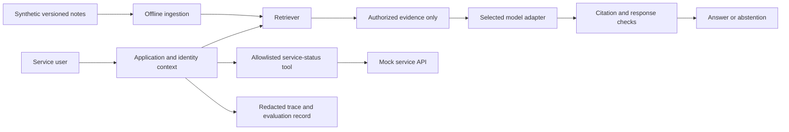

# Reference architecture — proposed

## Local PoC path

The model adapter and service integration are planned, not implemented. Start with keyword retrieval; a mock adapter tests interfaces only. Add a selected real model only after input/output and evaluation contracts exist.

## Interfaces

- Document: document ID, version, tenant ID, allowed roles, title, text and chunk IDs.
- Query: request ID, server-verified identity context, question and allowed-source scope. Do not trust a user-supplied tenant field as authorization.
- Retrieval result: chunk ID, document/version, ranking score and text; authorization precedes context assembly.
- Answer: supported text or abstention, cited chunk IDs, model/version, timing and usage metadata.
- Tool request: allowlisted operation and validated arguments; identity is injected by the application, never delegated to model choice.
- Trace: request ID, allowed source IDs, stage timings, error category and usage; no raw personal data or secrets.

## Proposed cloud path for 021

Authenticated edge -> application compute -> private document store/index and model service, with separate ingestion jobs, secrets management, audit/metrics and deployment pipeline. Map each component to one actual provider later. Record region, network route, encryption, identity permissions, backups, quotas and egress assumptions rather than claiming them implemented.

## Architecture decisions to review

1. Retrieval first, generation second: isolate retrieval quality before paying for model evaluation.
2. Managed model initially versus self-hosting: compare data requirements, operating burden, usage and latency with current sourced prices later.
3. Read-only tool first: add side effects only after authorization, confirmation and idempotency behavior are tested.
4. Tenant filtering before retrieval/context: verify denied sources never reach the model or trace payload.

## Failure behavior

Absent or conflicting evidence -> abstain with explanation. Retrieval/model timeout -> bounded error response; no invented fallback answer. Unauthorized tool -> deny and log a redacted event. Integration failure -> preserve trace and retry only where safe. Injection in documents or tool output -> treat it as data, not application authority.
